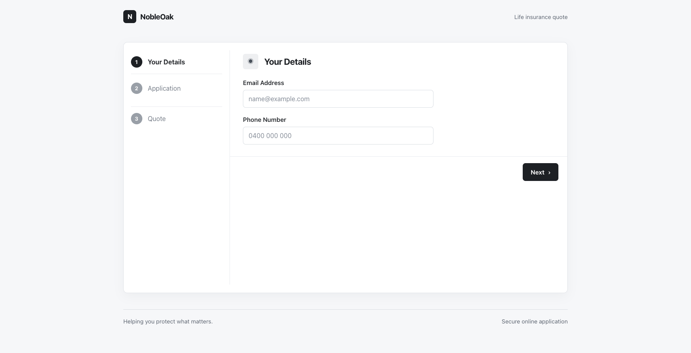
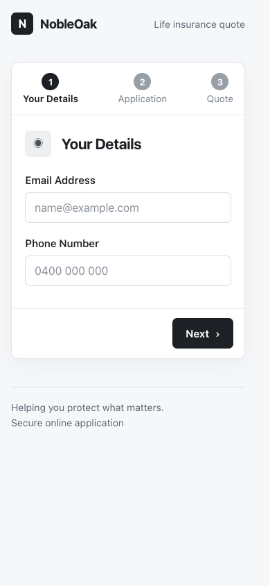

# NobleOak Quote Journey

A responsive React, TypeScript, and Vite application for a multi-step life insurance quote interview.

## Screenshot

| Desktop | Mobile (390px viewport) |
|---|---|
|  |  |

## Requirements

- Node.js 20.19+ or 22.12+
- npm

## Setup

```bash
npm install
npm start
```

Open the local URL printed by Vite (by default, `http://localhost:5173`). `npm start` starts the same development server.

The app loads its form from `GET /application` and submits answers to `POST /quote`. For a compatible API at a different origin, set `VITE_API_BASE_URL` in a local `.env` file before starting Vite:

```dotenv
VITE_API_BASE_URL=https://your-api.example.com/
```

Vite environment variables are embedded at build time. Do not put secrets in `VITE_*` variables.

## Checks

```bash
npm run test -- --run
npm run test:coverage -- --run
npm run lint
npm run build
```

## Assumptions

- The application endpoint returns pages and question metadata using the documented `pages` schema. Unknown question IDs are displayed using a humanized label.
- Quote requests use the JSON shape `{ "answers": { ... } }`. Answers are accumulated across all form steps; questions declared as `number` are sent as JSON numbers.
- `additionalQuestionsRequired` responses include one or more pages; those pages are appended to the application, and all answers are submitted again on the next quote request.
- Australian mobile numbers use the `04xx xxx xxx` format. Numeric questions accept non-negative whole numbers.
- The service’s returned option list is authoritative for select and radio inputs.

## Known limitations

- The interview API currently does not return browser CORS headers. The Vite development server proxies API calls to the default NobleOak service. A deployed frontend needs an equivalent same-origin reverse proxy or an API CORS policy allowing the frontend origin.
- Setting `VITE_API_BASE_URL` bypasses the development proxy; that API must permit browser requests from the local development origin.
- Sentry is only represented by an initialization placeholder; monitoring is not configured without a project DSN.
- The UI supports the question types currently returned by the service: text, email, number, select, and radio. New API question types need a renderer and validation behavior.
- The UI follows the supplied wireframe with project-defined CSS tokens and components; NobleOak's official company design system, brand assets, and approved design tokens have not been integrated. Before production, align typography, colors, spacing, and components with the current company design system.
- The interface is currently English-only; there is no localization framework, translated copy, or locale-selection support. Currency formatting uses the Australian locale.

## Approximate time

Approximately **2 hours total**, aligned with the interview exercise’s time-box. This is a retrospective estimate rather than measured time:

| Work area | Approx. time |
|---|---:|
| Reviewing requirements, API shape, and app structure | 15 min |
| Implementing the wizard flow, API integration, and dynamic follow-up steps | 40 min |
| Building responsive UI, shared components, and CSS Modules | 25 min |
| Adding validation, accessibility, and error handling | 20 min |
| Writing unit/integration tests, running checks, and documenting the project | 20 min |
| **Total** | **120 min** |

The estimate includes implementation and verification, but excludes environment setup, dependency installation time, and any production deployment or backend changes.

## AI assistance

An AI coding assistant was used during implementation to help draft and refine the React/TypeScript implementation, tests, and project documentation, and to troubleshoot build, lint, and test feedback. The resulting changes were reviewed and verified with the project test suite, ESLint, a production build, and a browser smoke test. Architectural choices and final changes remain the submitter's responsibility and should be explained during the assessment walkthrough.

## Project Architecture & Folder Structure

```text
src/
├── api/                            # Shared API client and request tests
│   ├── apiClient.ts
│   └── apiClient.test.ts
├── components/                     # Reusable presentation components
│   ├── Button.tsx
│   ├── Button.module.css
│   ├── Input.tsx
│   ├── Input.module.css
│   ├── Layout.tsx
│   ├── Layout.module.css
│   └── common/                     # Shared components used across features
│       └── ErrorBoundary.tsx
├── features/                       # Domain-specific vertical feature folders
│   └── insurance-journey/           # Insurance quote flow feature
│       ├── components/              # Feature-only UI components and styles
│       │   ├── DynamicFormRenderer.tsx
│       │   ├── FormStyles.module.css
│       │   └── StepStepper.tsx
│       ├── hooks/                   # Form state and quote API workflows
│       │   ├── useInsuranceForm.ts
│       │   ├── useInsuranceForm.test.ts
│       │   ├── useQuoteApi.ts
│       │   └── useQuoteApi.test.ts
│       ├── services/                # Feature API and response normalization
│       │   ├── insuranceService.ts
│       │   └── insuranceService.test.ts
│       ├── utils/                   # Feature validation and its tests
│       │   ├── validation.ts
│       │   └── validation.test.ts
│       ├── InsuranceJourneyContainer.tsx # Feature flow orchestration
│       └── InsuranceJourney.test.tsx # Wizard integration tests
├── monitoring/                     # Production monitoring integration point
│   └── sentry.ts                   # Sentry initialization placeholder
├── styles/                         # Global styles and design tokens
│   └── global.css
├── App.tsx                          # Root app and error boundary
└── main.tsx                         # React client entry point
```

The app is organized by feature: journey-specific UI, workflow hooks, API service, validation, and tests live together under `features/insurance-journey`. Shared HTTP and presentation concerns stay in `api/` and `components/`.

## Component Design & Tech Stack Constraints

- **Framework choice:** React was selected because the existing workspace is React/TypeScript-based and React’s component composition and hooks fit the multi-step form and its isolated state/API workflows.
- **React 19 + TypeScript 5.9:** strict TypeScript configuration and typed API/schema boundaries.
- **Vite 7:** development server, production bundling, and local API proxy; `npm start` and `npm run dev` start Vite.
- **CSS Modules:** component and journey styles are scoped with native `*.module.css` files and CSS variables. No Tailwind or utility-first CSS framework is used.
- **Composition:** `Layout` accepts `children`; shared `Button` and `Input` components keep presentation consistent.
- **Single responsibility:** `DynamicFormRenderer` maps API question schemas to controls, while the feature hooks own form state transitions and async API states.
- **Validation:** Zod-backed client validation enforces required fields, email/mobile formats, option membership, and non-negative whole-number answers before progressing.
- **Accessibility:** semantic forms and fieldsets, associated labels, accessible errors, keyboard-operable controls, and visible focus indicators.
- **Tests:** Vitest and React Testing Library cover utility/service/hook behavior and the end-to-end wizard interaction.
